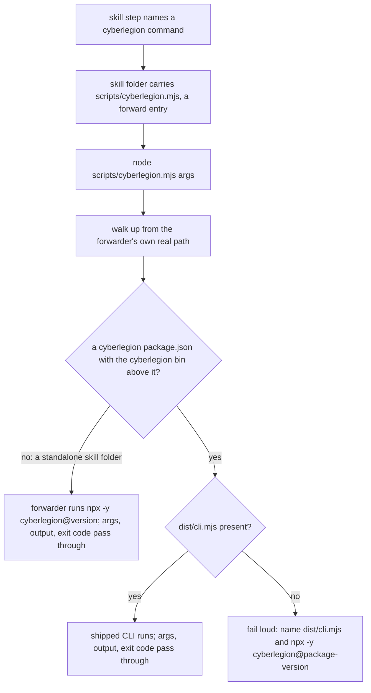
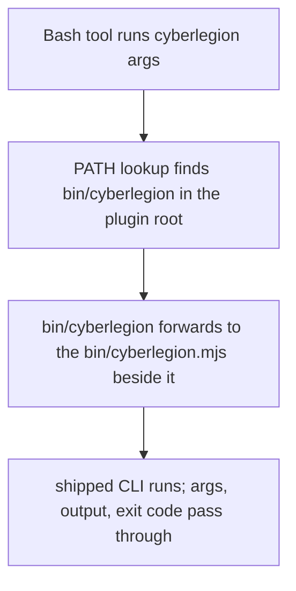
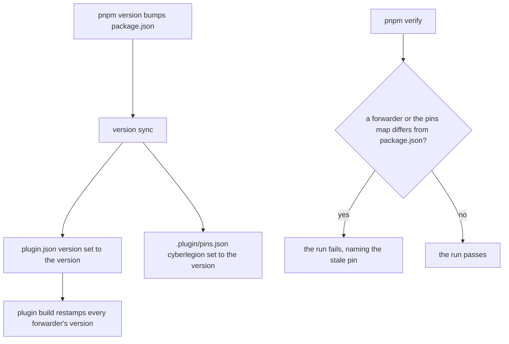

# cli-launcher — skills run the CLI they ship with

## What

Every plugin skill that runs a `cyberlegion` command runs it through a **forwarder**,
`scripts/cyberlegion.mjs`, that `universal-plugin plugin build` writes from a
`{ "forward": "cyberlegion" }` entry in `plugin.json`
([ADR 0022](https://github.com/cyberuni/universal-plugin/blob/main/packages/universal-plugin/.agents/spec/design/decisions/0022-skills-run-the-own-cli-through-a-forwarding-script.md)).
Skill bodies call it as `node scripts/cyberlegion.mjs <command>`, the path relative to the skill's
own folder, and name no other runner of the CLI: no `npx`, `upx`, or `pnpm exec` line beside it.

The forwarder holds none of the CLI. Walking up from its own real path, it finds the `cyberlegion`
package that contains it and runs that package's `bin/cyberlegion.mjs`, so a plugin install and a
dev checkout both run the CLI shipped beside the skill. A forwarder in a skill folder copied on its
own finds no such package and runs `npx -y cyberlegion@<version>` itself, so the skill still works
standalone. Its version is the one `plugin.json` carries when the build writes it, so the release
version flow keeps it current: `pnpm version` syncs `plugin.json` and the plugin's
`.plugin/pins.json` map from `packages/cyberlegion/package.json`, then runs `plugin build`, which
restamps every forwarder. The test suite fails when a forwarder or the map disagrees with that
version.

The package's `bin/` also carries `cyberlegion`, an extensionless, executable twin of
`bin/cyberlegion.mjs` that forwards every argument to it. Claude Code puts a plugin's `bin/` on the
Bash tool's PATH, where the file name is the command name, so a session (or a person at its prompt)
that types a bare `cyberlegion` runs the CLI the plugin ships, with no global install.

**Why.** The skills once called `npx cyberlegion@0.3.1 …` while the package was at 0.4.0, because
nothing moved the pin at release: a skill ran a CLI older than the one its own text describes. Each
npx call also paid npx's resolve-and-spawn cost and, with several agents running at once, risked the
`~/.npm/_npx` `ENOTEMPTY` race. The per-skill launcher that replaced it later became a compiled copy
of the whole CLI (209 KB per skill, over universal-plugin's 150 KB budget for a skill script), six
times over. A forwarder keeps npx off the common path, ships a few kilobytes, and needs no fallback
line in the skill: the choice of which CLI to run is code, not a sentence a model may skip.

**What makes it possible.** `dist/cli.mjs` is a committed, self-contained bundle, so
`bin/cyberlegion.mjs` runs at a git-source plugin install with no build and no `node_modules`.

**Non-goals** — which command a skill runs and when (each skill's own node); the CLI's commands
themselves (the sibling `packages/cyberlegion` CLI project); the forwarder's own code (universal-plugin
writes it; this node owns that each skill has one and what it reaches); the `mail hook` command
`init` writes into a harness's hook settings, `init --pin`, and bare `cyberlegion` calls in other
plugins (install-time decisions, outside this plugin's skills); `npx cyberlegion@<version>` examples in
the readmes and docs site (documentation, not a skill's invocation); a spawned unit's PATH shim (a CLI
concern, and absent in the user's own session, so no skill relies on it).

**Key terms** — **bare command**: `bin/cyberlegion`, the extensionless file Claude Code's PATH
exposes as `cyberlegion`. **forwarder**: `skills/<skill>/scripts/cyberlegion.mjs`, written by
`plugin build` from a `forward` entry. **Installed shape**: the package directory as a plugin install
copies it — no `node_modules`, only what the checkout or tarball carries. **Standalone folder**: a
skill folder copied with no `cyberlegion` package above it. **Version flow**: the repo's `pnpm version`
script, run at release.

## Use Cases

**Subject** — how a plugin skill reaches the `cyberlegion` CLI, and how the version a forwarder falls
back to is kept equal to the version that shipped it.

| Use case | Trigger | Inputs | Outcome |
|---|---|---|---|
| **run a CLI command from a skill** | a skill step names a `cyberlegion` command | the command's arguments; the working directory of the repo the agent works on | the command runs on the CLI shipped beside the skill, with its output and exit code unchanged |
| **run a bare `cyberlegion` in a Claude Code session** | the agent or the user types `cyberlegion <command>` in the Bash tool | the command's arguments | the command runs on the CLI shipped in the plugin's `bin/`, with its output and exit code unchanged |
| **cut a release** | the maintainer runs `pnpm version` | the new `package.json` version | every forwarder and the pins map name the new version |
| **catch a stale pin** | `pnpm verify` / CI | the tracked forwarders and the pins map | any version that disagrees with `package.json` fails the run |

**Actors** — the **agent** running a skill reaches the first use case; the **maintainer** cuts
the release; **CI** runs the check. The **user** whose session hosts the skill is affected without
invoking anything: they get the CLI version the skill's text describes, and no npx cache race.

**Extensions**

- *run a CLI command* — the skill folder was installed on its own, with no `cyberlegion` package
  above it: the forwarder runs `npx -y cyberlegion@<version>` itself, passing arguments, output, and
  exit code through. The skill still works standalone, only slower; the package is a fast path, not
  a dependency. The checkout carries no `dist/cli.mjs` (a source install that was never built): the
  forwarder runs `bin/cyberlegion.mjs`, which fails loud, naming the missing file and the pinned
  published version to run instead, rather than a raw module-not-found. The working directory is
  never used to find the CLI.
- *run a bare `cyberlegion`* — the plugin is distributed through claude.ai organization settings
  (or installed in claude.ai or Cowork): those reject a plugin with a top-level `bin/`, whatever it
  holds, so the bare command never exists there. The skills' forwarders do not rely on PATH, so they
  are unaffected. A harness that does not put `bin/` on PATH (Cursor, Codex) has no bare command
  either; this node promises it only where the harness exposes `bin/`.
- *cut a release* — `init-cyberlegion` reads `.plugin/pins.json` for `init --pin` (its own frozen
  suite, `init/`); this node owns only that the map is kept current. A failed `changeset version`
  stops the script chain before the sync runs.
- *catch a stale pin* — extensions: none; the check has one failure outcome.

## Control Flow

### 0 — A skill runs a CLI command

*Entered by:* run a CLI command from a skill

`ROOT` never consults the working directory: that is the user's repo, the command's input, not where
the CLI lives.

### 1 — A bare `cyberlegion` in a Claude Code session

*Entered by:* run a bare `cyberlegion` in a Claude Code session

`LOOKUP` is Claude Code's behavior; this node owns that the file is there, named `cyberlegion`,
executable, and shipped in the tarball. `FWD` locates `cyberlegion.mjs` from the file's own path, never
the working directory.

### 2 — Release keeps every pin current

*Entered by:* cut a release · catch a stale pin

## Scenario map

Every row is one edge from `## Control Flow`, bound to exactly one scenario in `cli-launcher.feature`;
every scenario in that suite has exactly one row.

### run a CLI command from a skill

| Edge | Path (Given) | Scenario |
|---|---|---|
| `STEP → FIND` | the plugin's skills | `every skill that runs the CLI ships a forwarder` |
| `FIND → CALL` | a skill body that names a CLI command | `a skill body runs every CLI command through its forwarder` |
| `CALL → ROOT` | a forwarder run from an unrelated working directory | `the forwarder finds the CLI from its own location, not the working directory` |
| `PKG → SELFFB` | a skill folder copied alone, with no package around it | `a forwarder in a standalone skill folder runs the pinned published CLI` |
| `DIST → RUN` | an installed-shape plugin directory with no node_modules | `a skill's forwarder runs the shipped CLI from an installed-shape plugin directory` |
| `RUN` (pass-through) | a command with arguments that exits non-zero | `arguments, output, and the exit code pass through the forwarder unchanged` |
| `DIST → MISSING` | an installed-shape directory without dist/cli.mjs | `a forwarder at a checkout without the built CLI names it and the pinned fallback` |

### run a bare `cyberlegion` in a Claude Code session

| Edge | Path (Given) | Scenario |
|---|---|---|
| `BARE → LOOKUP` | the package's bin/ | `the package ships an executable bin/cyberlegion` |
| `LOOKUP → FWD` | an installed-shape bin/ on PATH, run from an unrelated working directory | `a bare cyberlegion runs the shipped CLI from an unrelated working directory` |
| `FWD → BRUN` | a command the CLI rejects | `arguments, output, and the exit code pass through the bare command unchanged` |

### cut a release

| Edge | Path (Given) | Scenario |
|---|---|---|
| `SYNC → MANIFEST` | a plugin.json naming an older version | `the version flow rewrites the plugin manifest's version` |
| `MANIFEST → BUILD` | forwarders written at the manifest's version | `every forwarder embeds the plugin manifest's version` |
| `SYNC → MAP` | a pins map naming an older version | `the version flow rewrites the plugin's pins map` |

### catch a stale pin

| Edge | Path (Given) | Scenario |
|---|---|---|
| `STALE → FAIL` | a forwarder or the pins map that differs from package.json | `a pin that disagrees with the package version fails the test suite` |
| `STALE → PASS` | every forwarder and the pins map equal to package.json | `pins that match the package version pass the test suite` |
