# unit background — a unit hosted in a Claude background session

## What

A unit normally runs in a terminal multiplexer pane (tmux or herdr). Outside a multiplexer, a unit
whose harness is `claude` runs instead as a **Claude background session**: a session Claude Code
starts and keeps on its own, with no terminal window (`claude --bg`). Which backend a spawn uses is
[`mux`](../../mux/README.md)'s decision. This node holds what every per-unit operation does once a
unit lives in a background session: how it starts, how it is rung, read, shown, stopped, and closed,
and which operations it refuses.

A background session differs from a pane in ways that change each operation:

- It takes its **first turn from the prompt it was started with**, so there is no boot race to
  recover from.
- **Nothing can type into it while it runs.** A session is rung by stopping it and resuming it with
  the ring text as its next prompt, which only works while it is idle.
- Claude Code reports two things about each session. Its **status** says whether a turn is running:
  `busy` or `idle` (absent when no process runs). Its **state** is Claude Code's read of the *task*:
  `working`, `done`, `blocked` (waiting on a person, such as a permission prompt), `failed`, or
  `stopped`. The two are independent — an idle session whose task is unfinished reads `idle` +
  `working` — so whether a unit can be rung is read from **status**, and only `blocked` and `stopped`
  are read from state.
- It refuses to start in a folder Claude Code has not trusted, and there is no prompt to accept.
- There is no view to move focus to. A person opens one with `claude attach <id>`.

**Key terms** — **background session**: a Claude Code session started with `claude --bg`.
**listing**: Claude Code's session list, `claude agents --json --all`, one entry per session carrying
its short id, its session id, and its state; a stopped session stays listed with state `stopped`.
**short id**: the 8-character id `claude --bg` prints and `claude logs`, `stop`, and `rm` take; it is
the first 8 characters of the session id. **session id**: the full id; `claude --bg --resume` resumes
the same session only when given this form, and otherwise starts a copy. **locator**: the record field
that says where a unit's session lives; for this backend it carries the tag `claude-bg` and the short
id. **ring**: delivering a turn to a unit so it acts, here by stop then resume.

**Facts the CLI reads from Claude Code** (probed on Claude Code 2.1.299, ADR-0036; the
status-versus-state split was found by a live end-to-end run after the first freeze):

| Call | Success | Failure |
|---|---|---|
| `claude --bg --name <n> … "<prompt>"` | exit 0; stdout has `backgrounded · <short id>` | a folder Claude Code does not trust: exit 1, stderr starting `Workspace not trusted.`, nothing on stdout; anything else: non-zero with its own output |
| `claude --bg --resume <session id> "<prompt>"` on a stopped session | exit 0; stdout names the same short id, with `woke session <short id>` | stdout says it `started a copy` under another id, or a non-zero exit |
| `claude agents --json --all` | exit 0; a JSON array, possibly empty; each entry carries `id`, `sessionId`, `state`, and `status` when a process runs | non-zero exit, or output that is not a JSON array |

**Non-goals** — choosing the backend (`mux`); which records exist and when `prune` or reconcile marks
one exited ([`unit/registry`](../registry/README.md)); the ring `mail send` fires on delivery
([`mail/doorbell`](../../mail/doorbell/README.md)), which reaches this node's ring; worktree creation,
leasing, and close's worktree rules ([`unit/lifecycle`](../lifecycle/README.md)), which apply
unchanged. Out of scope for now: surfacing mail to a busy unit at the end of its turn (issue #190);
`unit clear` and `unit restart` on a background unit (refused here); reporting a
`blocked` unit in `unit who`; and showing the unit in a terminal tab (ADR-0034). The design record is
ADR-0036.

**An invalid state, outside the contract.** A unit whose record is active while Claude Code lists its
session as `stopped` is **invalid**. Two things can produce it: a ring whose resume failed after the
stop, and someone running `claude stop` on the session directly, outside cyberlegion. The owner ruled
both out of the contract. No operation's behavior on such a unit is specified (nudge, mail delivery,
show, prune), and no scenario covers it. A ring whose resume fails still **fails loud**; what happens
to the unit afterwards is not defined here.

## Use Cases

### Actors

| Actor | Goal |
|---|---|
| A Claude session with no multiplexer (plain terminal, IDE, desktop app) | hand a task to a peer and get its result back |
| A scheduler or headless Legate with no terminal at all | the same, unattended |
| A unit or owner sending a background unit mail or a steer | the unit acts on it |
| A person supervising the work | see what a unit is doing and what can be done to it, or step into it |
| An owner reusing a unit | give it a fresh context or a fresh session |
| Whoever ends a unit (its owner, a script) | pause it or remove it and reclaim what it held |
| A person in a multiplexer pane | take over a unit with the session they started by hand |

### `unit spawn` — start a unit in a background session

| | |
|---|---|
| Actor / goal | a caller with no multiplexer — get a peer working on a brief |
| Trigger | `unit spawn --harness claude` (or an `--agent` resolving to claude) where `mux` selected the background backend |
| Inputs | the brief, the launch (the `claude` command plus a definition's flags, or — through the library's `spawn` — a launch command whose first word is `claude`), `--handle`, the unit's folder (a leased worktree, or `--cwd`) |
| Outcome | a background session runs in the unit's folder, named after the unit's handle, with the unit's id and the CLI shim in its environment; its first turn is the spawn wake naming the brief file; the record carries the `claude-bg` locator with the printed short id. `--at` is read by nothing: there is no space to place. |

Extensions:

- `--no-wake` — refused before anything is created: a session started with no prompt reads `blocked`,
  which a ring cannot tell from a permission prompt, so the unit could never be rung.
- A library launch command whose first word is not `claude` — refused before anything is created: the
  background flags may not apply to it.
- The folder is not trusted — the session does not start; the worktree spawn leased is released, no
  record is written, and the error names the folder to trust. A `--cwd` folder has nothing to release.
- The session fails to start for another reason, including an exit 0 whose output names no short id
  — the same rollback, carrying Claude Code's output.

### `unit nudge` — ring a background unit

| | |
|---|---|
| Actor / goal | a unit, owner, or person — make the unit take a turn (by default: check its mail) |
| Trigger | `unit nudge <ref> [--message <text>]` on a unit whose locator is `claude-bg` |
| Outcome | the listing shows the session with status `idle` (and state not `blocked`); it is stopped, then resumed by its session id (read from the listing) with the message as its next prompt; the ring is reported once the resume says it woke the same short id |

Extensions:

- The unit's record is `stopped` — not rung: a stopped unit stays stopped until its owner acts; no
  Claude command is run.
- The session's state is `blocked` — not rung, reported as waiting on a person with
  `claude attach <id>` as the next step; the session is not stopped. Checked before status.
- The session's status is `busy` — not rung, reported as busy; the session is not stopped.
- The session reports neither `busy` nor `idle` (no process, a `failed` task) — not rung; fails
  saying it is not idle; the session is not stopped.
- The session is not in the listing — fails naming the gone session.
- The listing cannot be read — fails; nothing is stopped.
- `claude stop` fails — fails loud; nothing is resumed.
- The resume exits non-zero or starts a copy — fails loud. The unit is left in the invalid state
  above; nothing further is specified.

### `unit read` — see a background unit's output

| | |
|---|---|
| Actor / goal | a person or caller — see what the unit is doing |
| Trigger | `unit read <ref> [--lines <n>]` |
| Outcome | the session's recent output from `claude logs`, with terminal control sequences removed, bounded to the last `<n>` lines when given |

Extensions: the log cannot be read (the session is gone) — fails naming the session.

### `unit show` — where the runtime is, and what works on it

| | |
|---|---|
| Actor / goal | a person or controller — know whether the unit is running and which verbs apply, without changing anything |
| Trigger | `unit show <ref>` on a unit whose locator is `claude-bg` |
| Outcome | the backend reads `claude-bg`. A record that is `stopped` reports liveness `stopped`, as for any unit (`unit/runtime`), with `close` as its only control. Otherwise liveness comes from the listing: `live` when it lists the session (in any state but `stopped`, which on an active record is the invalid state above), `gone` when it parses without it, `unknown` when it cannot be read. The controls are `nudge`, `read`, `stop`, and `close` for a live unit, and `close` alone otherwise — never `restart`, `clear`, or `focus`. |

Extensions: covered by the liveness outcomes above.

### `unit focus` — refused

| | |
|---|---|
| Actor / goal | a person — look at the unit |
| Trigger | `unit focus <ref>` |
| Outcome | refused, naming `claude attach <short id>` as the way to open it; nothing is run |

Extensions: none — the refusal is the only path; there is no attached view to move.

### `unit stop` — end the session, keep the unit

| | |
|---|---|
| Actor / goal | the unit's owner — free the session without losing the unit's work |
| Trigger | `unit stop <ref>` |
| Outcome | `claude stop <short id>` is run, and the listing then shows the session `stopped`; the record is `stopped` and **keeps its `claude-bg` locator**, so `close` can later delete the session. `claude rm` is not run, so the conversation is kept. |

Extensions:

- The session is not in the listing — nothing to stop; the record is marked `stopped`.
- The listing still shows the session in another state after the stop — fails loud ("stop did not
  take effect"); the record is unchanged.
- The listing cannot be read after the stop — the record is marked `stopped`, reported as unverified.

### `unit close` — remove the unit

| | |
|---|---|
| Actor / goal | whoever ends the unit — reclaim the session, the worktree, and the record |
| Trigger | `unit close <ref>` |
| Outcome | `unit/lifecycle`'s close runs as for any unit — its refusals and its worktree removal (or, for a leased worktree, the lease release) come **first**; only then is the session torn down (`claude stop`, then `claude rm`), and the record reaped |

Extensions:

- A lifecycle refusal (a dirty worktree without `--force` on a unit holding no lease, the primary
  checkout), or a worktree removal that fails — the close stops there with the session untouched, so the retry still has it.
- The session is already gone, or already stopped — the teardown commands may fail; the reap still
  completes.

### `unit rebind` — refused for a background unit

| | |
|---|---|
| Actor / goal | a person in a multiplexer pane — make their hand-started session be this unit |
| Trigger | `unit rebind <ref>` naming a unit whose record carries a `claude-bg` locator |
| Outcome | refused, naming the background backend; the record and its locator are unchanged. Rebinding would replace the locator with the caller's pane and leave the background session with nothing that can delete it. |

Extensions: none — refusal is the only path. A caller in no pane is refused by `unit/runtime` already.

### `unit clear`, `unit restart` — refused for now

| | |
|---|---|
| Actor / goal | an owner reusing a unit — a fresh context, or a fresh session |
| Trigger | `unit clear <ref>` or `unit restart <ref>` |
| Outcome | refused, naming the background backend as unsupported; no Claude command is run |

Extensions: none — refusal is the only path until a follow-up adds them.

### Surface trace

| Element | Use case | May not combine with |
|---|---|---|
| `unit spawn --no-wake` | spawn | the background backend (refused) |
| the library `spawn`'s launch command (no CLI flag) | spawn | the background backend, unless its first word is `claude` |
| `unit spawn --at` | spawn | read by nothing on this backend |
| `unit nudge --message` | nudge | — |
| `unit read --lines` | read | — |

## Control Flow

```mermaid
graph TD
  subgraph spawn
    SP0["unit spawn, backend = background"] --> SP1{"--no-wake?"}
    SP1 -- yes --> SPR1["refuse; create nothing"]
    SP1 -- no --> SP2{"launch's first word is claude?"}
    SP2 -- no --> SPR2["refuse; create nothing"]
    SP2 -- yes --> SP3["resolve the folder (worktree lease or --cwd)"]
    SP3 --> SP4["claude --bg --name handle, launch flags, wake prompt;<br/>env: unit id + CLI shim; cwd: the folder"]
    SP4 --> SP5{"exit 0 and the output names a short id?"}
    SP5 -- "no: Workspace not trusted" --> SPR3["release a leased worktree; no record;<br/>error names the folder"]
    SP5 -- "no: other failure, or no short id" --> SPR4["release a leased worktree; no record;<br/>carry claude's output"]
    SP5 -- yes --> SP6["record: claude-bg locator with the short id;<br/>first turn reported delivered"]
  end

  subgraph nudge
    N0["unit nudge on a claude-bg unit"] --> N00{"record stopped?"}
    N00 -- yes --> NS["refuse: stopped; run nothing"]
    N00 -- no --> N1{"listing readable?"}
    N1 -- no --> NL["fail; stop nothing"]
    N1 -- yes --> N2{"session listed? state blocked? status?"}
    N2 -- "not listed" --> NG["fail: session gone"]
    N2 -- "state blocked" --> NK["not rung: waiting on a person; no stop"]
    N2 -- "status busy" --> NB["not rung: busy; no stop"]
    N2 -- "neither busy nor idle" --> NN["fail: not idle; no stop"]
    N2 -- "status idle" --> N3{"claude stop succeeds?"}
    N3 -- no --> NSF["fail loud; resume nothing"]
    N3 -- yes --> N4{"resume by session id woke the same short id?"}
    N4 -- yes --> NOK["report rung"]
    N4 -- "no: copy or non-zero" --> NF["fail loud: left stopped"]
  end

  subgraph read
    R0["unit read"] --> R1{"claude logs succeeds?"}
    R1 -- yes --> R2["strip control sequences; bound by --lines"]
    R1 -- no --> RF["fail naming the session"]
  end

  subgraph show
    H0["unit show"] --> H0S{"record stopped?"}
    H0S -- yes --> HS["liveness stopped; controls: close"]
    H0S -- no --> H1{"listing readable?"}
    H1 -- no --> HU["liveness unknown; controls: close"]
    H1 -- yes --> H2{"session listed?"}
    H2 -- yes --> HL["liveness live; controls: nudge, read, stop, close"]
    H2 -- no --> HG["liveness gone; controls: close"]
  end

  subgraph stop
    S0["unit stop"] --> S1["claude stop"]
    S1 --> S2{"listing after the stop?"}
    S2 -- "unreadable" --> SU["mark stopped, keep locator; unverified"]
    S2 -- "not listed, or stopped" --> SV["mark stopped, keep locator; verified"]
    S2 -- "listed in another state" --> SF["fail: did not take effect; record unchanged"]
  end

  subgraph close
    C0["unit close"] --> C1{"lifecycle refusals and worktree removal pass?"}
    C1 -- no --> CR["stop; session untouched"]
    C1 -- yes --> C2["claude stop; claude rm (failures tolerated)"]
    C2 --> C3["reap the record"]
  end

  subgraph refused
    F0["unit focus"] --> FR["refuse; name claude attach"]
    X0["unit clear / unit restart"] --> XR["refuse; run nothing"]
    B0["unit rebind"] --> BR["refuse; record unchanged"]
  end
```

`unit nudge` reports a ring by what the resume printed, not by polling the session's state: a quick
turn can go from `busy` back to `idle` between two polls and read as never started. The resume waking
the same short id is the same evidence spawn already takes for its first turn.

## Scenario map

Binds each edge above to its scenario in [`background.feature`](./background.feature), grouped by use
case.

### `unit spawn`

| Edge | Path (Given) | Scenario |
|---|---|---|
| `SP5 -- yes` → `SP6` | a worktree spawn, the folder trusted | `a background spawn starts the session in the unit's folder with the spawn wake as its first prompt` |
| `SP6` | a started session whose output names a short id | `a background spawn records the printed short id on the unit's record` |
| `SP4` | a started session | `a background spawn starts the session with the unit's id and the CLI shim in its environment` |
| `SP4` | a spawn with `--handle` | `a background spawn names the session after the unit's handle` |
| `SP0` | a spawn with an explicit `--at` | `a background spawn opens no multiplexer space whatever --at names` |
| `SP1 -- yes` | `--no-wake` | `a background spawn refuses --no-wake before creating anything` |
| `SP2 -- no` | a library launch command whose first word is another program | `a background spawn refuses a launch that is not the claude command before creating anything` |
| `SP2 -- yes` | a library launch command whose first word is `claude` | `a background spawn accepts a launch command that runs claude with its own flags` |
| `SP5 -- no: not trusted` | a worktree spawn | `a background spawn into an untrusted folder releases its worktree and registers nothing` |
| `SP5 -- no: not trusted` | a `--cwd` spawn | `a --cwd background spawn into an untrusted folder registers nothing and names the folder` |
| `SP5 -- no: other failure` | a worktree spawn, a non-zero exit | `a background session that fails to start releases the worktree and registers nothing` |
| `SP5 -- no: no short id` | a worktree spawn, exit 0 with no short id in the output | `a background spawn whose output names no session releases the worktree and registers nothing` |

### `unit nudge`

| Edge | Path (Given) | Scenario |
|---|---|---|
| `N4 -- yes` | status idle, state working, `--message` given | `nudge on an idle background unit resumes it with the message as its next prompt` |
| `N4 -- yes` | status idle, no `--message` | `nudge with no message rings an idle background unit with the default check-mail message` |
| `N4 -- no` | the resume starts a copy | `nudge fails loud when the resume starts a copy instead of waking the unit` |
| `N3 -- no` | `claude stop` fails | `nudge fails loud and resumes nothing when the stop fails` |
| `N2 -- status busy` | a session in a turn | `nudge on a busy background unit reports it busy and leaves the session running` |
| `N2 -- neither busy nor idle` | no status, state failed | `nudge on a background session reporting neither busy nor idle fails and stops nothing` |
| `N2 -- state blocked` | a session waiting on a person | `nudge on a blocked background unit reports it waiting on a person and leaves it untouched` |
| `N2 -- not listed` | a listing without the short id | `nudge on a background unit whose session is gone fails naming it` |
| `N1 -- no` | the listing command fails | `nudge fails and stops nothing when Claude Code's listing cannot be read` |
| `N00 -- yes` | a stopped unit | `nudge on a stopped background unit is refused and runs no Claude command` |

### `unit read`

| Edge | Path (Given) | Scenario |
|---|---|---|
| `R1 -- yes` | `--lines` given | `read prints a background unit's log without control sequences, bounded by --lines` |
| `R1 -- no` | a session Claude Code no longer has | `read on a background unit whose log cannot be read fails naming the session` |

### `unit show`

| Edge | Path (Given) | Scenario |
|---|---|---|
| `H2 -- yes` | an active record, a listed session with status busy | `show reports a running background unit live with the controls that work on it` |
| `H2 -- no` | an active record, a listing without its short id | `show reports a background unit gone when the listing does not contain it` |
| `H0S -- yes` | a stopped record | `show offers only close for a stopped background unit` |
| `H1 -- no` | the listing command fails | `show reports a background unit's liveness unknown when the listing cannot be read` |

### `unit stop`

| Edge | Path (Given) | Scenario |
|---|---|---|
| `S2 -- stopped` | a listed busy session whose state reads `stopped` after | `stop on a background unit stops the session and keeps its conversation and locator` |
| `S2 -- not listed` | a listing without the short id | `stop on a background unit whose session is gone marks it stopped` |
| `S2 -- another state` | a session whose state is still not `stopped` after the stop | `stop fails loud when the background session is still running after the stop` |
| `S2 -- unreadable` | the listing fails after the stop | `stop reports an unverified stop when the listing cannot be read` |

### `unit close`

| Edge | Path (Given) | Scenario |
|---|---|---|
| `C1 -- yes` → `C3` | a `--cwd` unit, session idle | `close on a background unit stops and deletes the session` |
| `C1 -- yes` → `C3` | a leased worktree, session idle | `close on a leased background unit releases the lease and deletes the session` |
| `C1 -- no` | a `--worktree-path` worktree (no lease) with uncommitted changes, no `--force` | `a refused close leaves the background session untouched` |
| `C1 -- no` | a `--worktree-path` worktree (no lease) whose removal fails | `a close whose worktree removal fails leaves the background session untouched` |
| `C2` failures tolerated | the session already deleted from Claude Code | `close on a background unit whose session is gone still reaps the record` |

### `unit focus`, `unit clear`, `unit restart`, `unit rebind`

| Edge | Path (Given) | Scenario |
|---|---|---|
| `FR` | any background unit | `focus on a background unit is refused naming claude attach` |
| `XR` clear | any background unit | `clear on a background unit is refused and runs nothing` |
| `XR` restart | a stopped background unit | `restart on a background unit is refused and runs nothing` |
| `BR` | a caller in a tmux pane, a stopped background unit | `rebind onto a background unit is refused and keeps its locator` |
